# Pokémon Crystal Inheritance

This is a custom Pokémon game based on [the Pokémon Crystal disassembly](https://github.com/pret/pokecrystal). 
The game was built using Polished Crystal 3.0.0 as a base by dwg (Reddit username: u/dwg6m9)

## About Crystal Inheritance

Crystal Inheritance is a time-traveling adventure through Johto! In a twist on the classic Pokemon experience, instead of collecting badges to become champion, you unite Johto against a dark force threatening its future.

When Ilex Forest is threatened, Celebi calls out for help. Can you go back in time to save Johto's future? 

Use your knowledge of the world to craft pokéballs from new apricorns, discover Hisuian and Ancestor forms of Johto Pokémon, and explore Johto like never before. 

In historic Johto, you'll see the power-hungry Emperor Mejimi and his generals Bobesh, Kensey, and Adrinna use a crisis to consolidate power.

In modern Johto, you'll confront Johto's wayward gym leaders as they wonder how to cope with a changing world. 

Nothing is inevitable - what path will you choose?

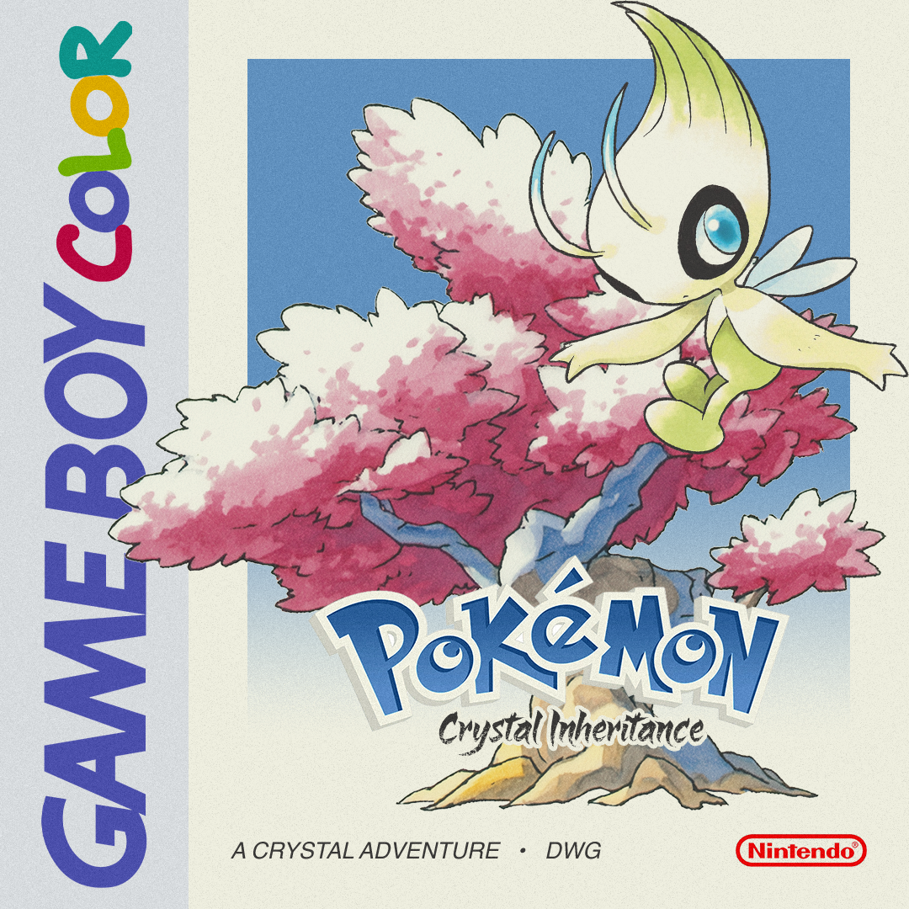 

# Features

## Custom Features to Inheritance

* New region: Historic Johto
* Custom Pokédex of 254 includes Sinnoh and Hisui Pokémon
* New apricorn system to craft new Pokéballs: Bub Ball, Herb Ball, Deci Ball, Jeze Ball, and Geode crafted from materials on the overworld.
* "Hidden Palette" system where NPCs can adjust your Pokémon DVs to take on unique palette and grant the corresponding hidden power. 
* Emphasis on overworld puzzles exploiting time travel mechanic 
* "Trick House" in historic Ilex Forest
* Two possible endings
* Three difficulty modes: Easy, where enemies have no EVs or items; Normal, which is a tough but fair challenge; and Expert, where bosses have full teams of 6 with coverage moves and even higher EVs. 
* The entire dex can be caught in one game.
* Sandbox Room that grants you items, a random Pokémon of any given type, or all Pokémon so you can play how you want to. 
* HM moves do not require move deleter to overwrite.
* Kurt will battle you for extra experience throughout the game to give you experience and help you get locations for rare Pokémon. 
* Whirlpool is now called "Vortex". It is Psychic-type Bulldoze and can be learned by most Water, Psychic, Ghost, and Fairy types. 

## Notable features carried from Polished Crystal 3.0.0

* Modern techniques
* New mechanics, including the Fairy type, Physical/Special split, Natures, unlimited TMs, Running Shoes, and continuous Repel.
* Music and graphics devamped from other versions.
* Nuzlocke mode in the Option menu, enabling the basic rules of the [Nuzlocke Challenge](http://bulbapedia.bulbagarden.net/wiki/Nuzlocke_Challenge).
* Learnsets have been updated close to Gen VI, with missing moves replaced by similar, egg, TM, or event-exclusive moves. See data/Pokémon/evos_attacks or data/Pokémon/base_stats/<name> for level-up and TMHM learnsets.
* Hold B to use Running Shoes, or turn on the Option to always use them.
* Continuous Repel system.
* Cure poison when it reaches 1 HP outside a battle.
* Eggs hatch at level 1.
* Surf at Bicycle/Running Shoes speed.
* Maximum $9,999,999 money and 50,000 coins.
* Maximum 30 items and 16 Balls in your bag pocket.

## Gameplay

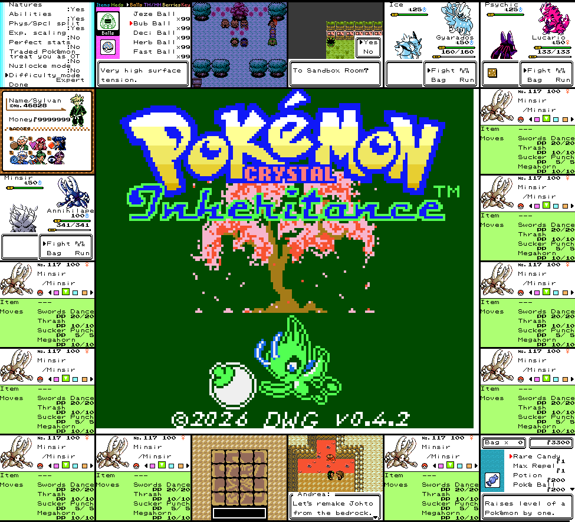 

## New Mechanic: Expanded Apricorn Crafting System 

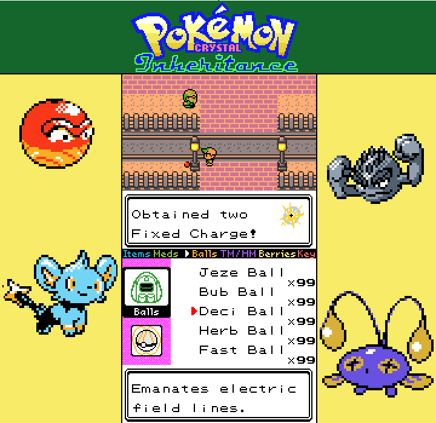 

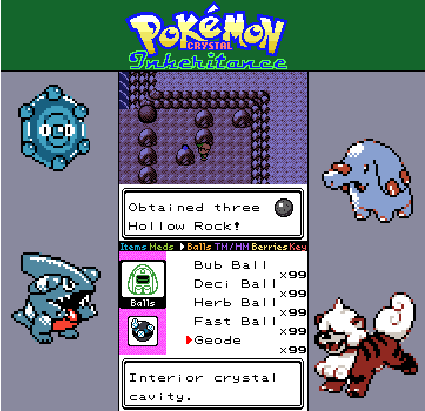 

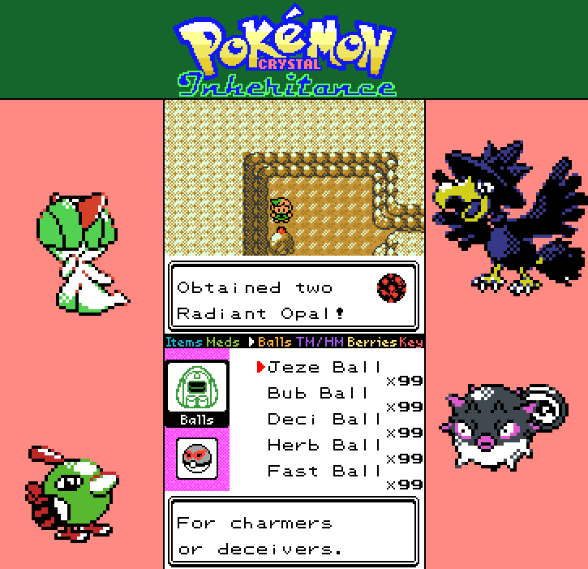 

## New Hidden Palette Colors

Pokémon with the highest possible DV for a given hidden power type will have a palette to match. There are 6 NPCs who can grant these DVs to one of your Pokémon during your playthrough, and one more once you reach the credits. 

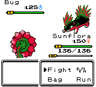 
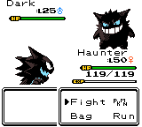 
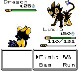 
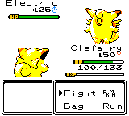 
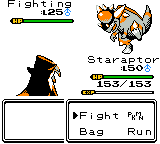 
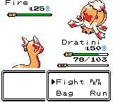 
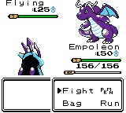 
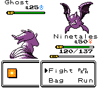 
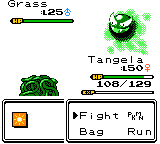 
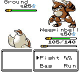 
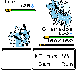 
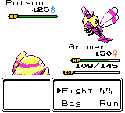 
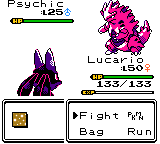 
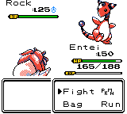 
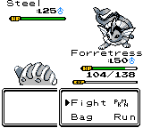 
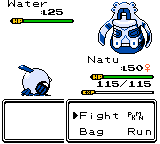 

## Pokedex

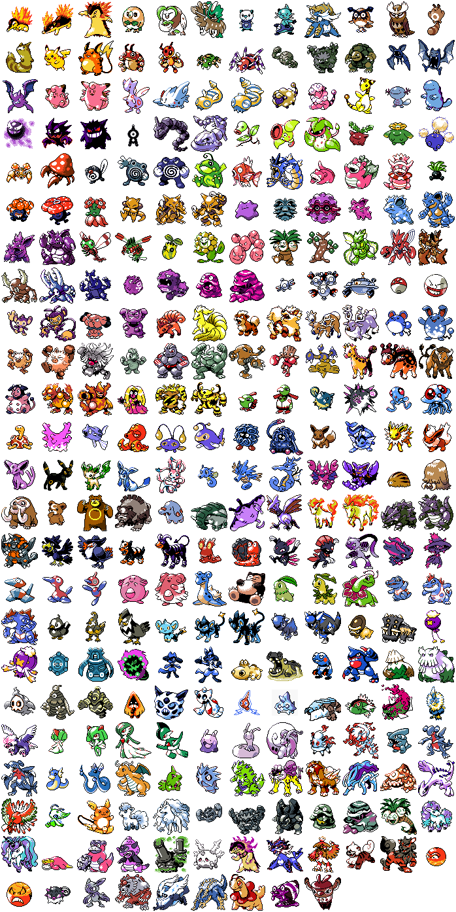 